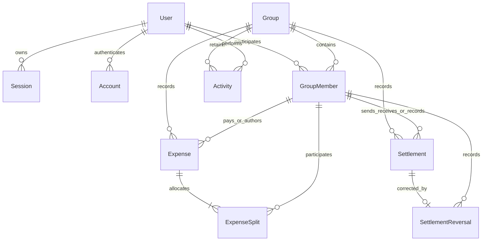

# FairShare — critically reviewed architecture

**Reviewed design; Phase 1 only approved and implemented.** Reviewed 4 November 2026 (Asia/Dhaka). Initial draft is preserved at docs/architecture-initial.md. See docs/PHASE_1_REPORT.md for implemented auth/foundation scope; the domain design below remains an inactive proposal. Further implementation requires explicit approval.

## 1. Compatibility: supported, not yet runtime-proven

| Component | Selected version | Verification |
| --- | --- | --- |
| Node.js | 24 LTS; local 24.15.0 | Satisfies installed Next and proposed Prisma engine requirements |
| Next.js | 16.4.5, App Router, Node runtime | Installed; Better Auth declares Next ^14/^15/^16 support |
| React / TypeScript | Installed 19.3.1 / 5.9.3 | Supported by installed Next/Better Auth metadata and Prisma TS >=5.4 requirement |
| Better Auth | **1.7.16** | Installed core and Prisma adapter match; Prisma adapter declares Prisma 5/6/7 support |
| Prisma CLI / client / adapter-pg | **7.10.1 for all three** | Read-only npm metadata confirms packages exist; CLI Node range ^20.19 / ^22.12 / >=24 |
| PostgreSQL | 18 | Local installed 18.1; deploy a maintained PostgreSQL 18 patch release |

The selected combination is now installed and runtime-verified for Phase 1 auth: schema validation/client generation, clean database migrations and real Better Auth HTTP/browser checks pass. The active prisma/schema.prisma contains auth models only; the full domain schema.proposal.prisma is still not applied or CLI-validated. Do not extend the auth result into claims about domain models. Versions are pinned; Prisma 8/RC APIs were not adopted.

Runtime finding: Prisma pg 7.10.1 requires an explicit UTC connection timezone on this Dhaka-configured PostgreSQL cluster to preserve timestamptz expiry instants. src/lib/db/prisma.ts sets it; the retained expiration regression passes. See [upstream issue](https://github.com/prisma/orm/issues/28629).

Prisma 7 requires ESM, explicit `prisma-client` output, version-appropriate prisma.config.ts, and runtime `@prisma/adapter-pg`. Use one client/pool per process, finite connection and transaction timeouts, and TLS verification. A direct migration URL may differ from the runtime pool URL. [Prisma 7 configuration](https://docs.prisma.io/docs/guides/upgrade-prisma-orm/v7), [Better Auth Prisma integration](https://better-auth.com/docs/adapters/prisma).

Retain `/api/auth/[...all]` GET/POST. Auth forms will use Server Actions: configure `nextCookies()` last to propagate sign-in/sign-up/sign-out cookies. Session checks use `auth.api.getSession({headers: await headers()})`. Explicitly enable Prisma adapter `transaction: true` (confirmed in installed adapter types; defaults false). Generate/compare the auth schema using matching Better Auth tooling before migration. Auth transactions are separate from group-ledger transactions. [Better Auth Next.js integration](https://better-auth.com/docs/integrations/next).

## 2. Findings that changed the design

| Finding | Correction |
| --- | --- |
| Prisma version was unspecified; current docs span incompatible major APIs | Select 7.10.1 with supported Better Auth 1.7.16; test generated client/auth before feature migration |
| Auth cookie handling and transaction default omitted | nextCookies last; Prisma adapter transactions explicitly enabled |
| One active boolean cannot distinguish leaving from removal | ACTIVE/LEFT/REMOVED membership states; old invitations cannot undo admin removal |
| Blanket freeze of former-member expenses blocks harmless corrections | Permit edits only when every inactive member's financial delta stays zero; preserve existing inactive references, introduce none |
| Immutable payment with no correction workflow can trap a mistaken debt | Add one full append-only SettlementReversal, reason/actor/time; never edit/delete recorded payments |
| Audits lost actor display identity on name changes | Snapshot actorName and a snapshot schemaVersion; retain actor ID |
| Expense creation retries could duplicate bills | Actor/group creation request key plus original canonical payload fingerprint |
| SQL CHECK/FK guarantees were overstated | Local constraints in SQL; split totals, parent-type input rules and permissions remain transactional service invariants |
| Blanket audit trigger was presented as sufficient immutability | Non-owner runtime role with SELECT/INSERT only on immutable tables; separate migrator/maintenance role |
| Raw test URL comparison/rollback cleanup was unsafe | Parse DB identities, test-only CONNECT grants, separate test and shadow DBs, real committed concurrency fixtures |
| Hashed invite cannot be displayed again as a raw URL | Reveal only at creation; generate a new link when needed |

Settlement reversal is a small additional corrective workflow proposed for approval. Other production gaps (disputes, receiver confirmation, account erasure, password recovery, shared rate limiting) remain explicit limits, not hidden claims of completeness.

## 3. Final database relationships

Better Auth owns User/Session/Account/Verification. User IDs remain strings; do not assume UUIDs. Verification identifiers do not require an existing User. Domain record IDs are UUIDs. GroupMember has composite PK(groupId,userId), role, status and timestamps, and is retained permanently for financial references.

Expense has one payer, immutable author, BIGINT total, SQL DATE, split type, version, creation request key/fingerprint and soft deletion. ExpenseSplit has one row per included member, final poisha and original validated input units. Payer need not be included. Composite member FKs bind payer/author/participants to the same group; `(groupId,expenseId)` binds each split to its own group's expense. These constraints do not enforce active status or roles.

Settlement stores immutable sender/receiver/recorder/amount/method/request key. SettlementReversal references the original by `(groupId,settlementId)`, once only; derive amount and parties from the original. It is a full ledger correction, not a transfer/refund. Partial correction means full reversal then a correctly recorded payment.

Activity stores group, actor ID, actor-name snapshot, event/entity ID, server timestamp, schemaVersion and before/after JSON. No expense FK/cascade: deleted expenses retain history. Monetary snapshot fields are strings. Group deletion is soft deletion, revokes invites and hides normal access while retaining the deletion event and ledger. It is not personal-data erasure. Disable account deletion in core; retained membership/audit User FKs intentionally restrict physical user deletion until an erasure/anonymization policy exists.

No Balance table, separate ExpenseRevision table, generic ledger framework or separate Express server. Before/after snapshots provide revision history. A separate Invite table is unnecessary for one current reusable group link; add only for multiple/recipient-specific invitations. See inactive prisma/schema.proposal.prisma for the concrete proposal.

## 4. Important indexes and constraints

| Table | Index / constraint | Reason |
| --- | --- | --- |
| Auth | User email UNIQUE; Session token UNIQUE + userId index; Account(providerId,accountId) UNIQUE + userId index; Verification(identifier) | Identity/session/provider lookups |
| Group | PK(id); inviteTokenHash UNIQUE | Group lookup/lock and token hash lookup |
| GroupMember | PK(groupId,userId); index(userId,status,groupId) | Permission and home-group queries |
| GroupMember | SQL partial UNIQUE(groupId) WHERE role=ADMIN AND status=ACTIVE | At most one active admin; service creation/lifecycle rules ensure at least one for a live group |
| Expense | UNIQUE(groupId,id); UNIQUE(groupId,createdById,requestKey); index(groupId,deletedAt,date,id); index(groupId,paidById) | Scoped split FK, retry protection, stable pagination, payer lookup |
| ExpenseSplit | PK(expenseId,userId); index(groupId,userId) | No duplicate participant and member breakdown |
| Settlement | UNIQUE(groupId,id); UNIQUE(groupId,createdById,requestKey); index(groupId,createdAt,id); indexes(groupId,fromId) and (groupId,toId) | Reversal FK, retries, history, party lookup |
| SettlementReversal | UNIQUE(groupId,settlementId); indexes(groupId,createdAt,id) and (groupId,createdById) | One reversal and scoped history/recorder lookup |
| Activity | index(groupId,createdAt,id) | Stable cursor feed |

Do not duplicate PK/unique indexes or add standalone low-selectivity booleans. Review actual query plans before covering indexes/caches. Expense creation uniqueness already covers author FK lookups.

SQL CHECKs: amount 1..100,000,000 poisha, split amount >=0, inputUnits NULL or nonnegative, version >0, sender != receiver. Enums and field lengths bound other values. A simple CHECK cannot sum child rows or inspect parent splitType. Server services validate exact totals, percentage sum/bounds and positive integer weights inside the same transaction as all allocation writes. A future independent DB writer would need equivalent safeguards or deferred integrity triggers; none is planned.

Use a non-owner runtime role. Activity, Settlement and SettlementReversal are SELECT/INSERT only; no UPDATE/DELETE/TRUNCATE. Migrator and test maintenance credentials are separate. Application-only immutability is insufficient; database owners can still change history, so do not claim tamper-proof auditing.

## 5. Financial representation and accounting

PostgreSQL BIGINT and TypeScript bigint represent poisha exactly. Cap one expense/payment at BDT 1,000,000. Parse digit strings directly: "100.01" -> 10001n. Reject signs, exponents, extra decimal places, excessive length and malformed inputs. Never use parseFloat or decimal Number arithmetic. Percentages use 0.01% basis points (sum 10,000); share weights are integers 1..1,000,000. Proportional products/divisions use BigInt. Saved final allocations are authoritative so later algorithm changes cannot change old bills.

SQL SUM(bigint) returns exact numeric, not bigint. Fetch aggregate results as integer text and parse BigInt; do not narrow to int64 or coerce to Number. Coalesce empty sums to exact zero. PostgreSQL BIGINT itself has a signed 64-bit range; the per-record limit stays well within it. [PostgreSQL numeric types](https://www.postgresql.org/docs/18/datatype-numeric.html), [aggregate return types](https://www.postgresql.org/docs/18/functions-aggregate.html).

DTO and audit money is explicitly named base-10 poisha strings, e.g. `{amountPoisha:"10001"}`. Date DTOs are YYYY-MM-DD, timestamps UTC ISO. Serialize at explicit DTO boundaries; never return raw Prisma records or patch BigInt.prototype globally. JSON.stringify rejects raw BigInt. Presentation formatting uses integer quotient/remainder and BigInt-safe grouping. [Prisma BigInt serialization](https://www.prisma.io/docs/orm/v7/prisma-client/special-fields-and-types).

Allocate by largest remainder, with a stable-ID ordering rotated by server-assigned expense ID for ties. Preserve the ID across edits. Server allocations override previews. This avoids a fixed tie winner, but is not guaranteed long-term equality and can be gamed by repeated create/delete; document this honestly.

**Positive = is owed; negative = owes.**

`net = paid − allocated shares + payments sent − payments received − reversed payments sent + reversed payments received`

A pays 100 and A/B share 50 each => A +50, B −50. B pays A 50 => both zero. Reversing that recorded payment restores the original balances. Include inactive members in the ledger, assert sum == 0n and fail visibly on corruption. Suggestions must use the full ledger, not a paginated subset.

Greedy largest-debtor/largest-creditor matching is deterministic and clears k nonzero balances in at most k−1 positive non-self payments; it is not globally optimal. Counterexample debtors 8,7,6 / creditors 9,8,4 takes five greedy payments, while four suffice. Exact search is outside core.

## 6. Server-side permission boundaries

| Operation | Mandatory authority/rules |
| --- | --- |
| Read group/ledger/feed | Valid server session, ACTIVE membership, live group |
| Add expense | ACTIVE member; same-group active payer/participants |
| Edit/delete expense | ACTIVE author or ADMIN; same-group resource; expected version; inactive-member financial guard |
| Record settlement | ACTIVE parties, debtor→creditor within both current limits; recorder is involved party or ADMIN |
| Reverse settlement | ACTIVE original recorder or ADMIN; reason; original in same group, not already reversed; inactive-member guard |
| Issue/rotate/revoke invite | ACTIVE ADMIN |
| Join | Authenticated user; current unexpired token; live group; member limit; REMOVED users denied |
| Leave/remove | MEMBER self-leave or ADMIN removing MEMBER; exact zero balance |
| Reactivate REMOVED member | Explicit audited ADMIN action |
| Delete group | ACTIVE ADMIN; exact-name confirmation; soft delete + revoke invite + audit |

LEFT members may rejoin with a current valid invitation. REMOVED members require admin reactivation. Do not delete membership rows or allow a generic link to undo removal. The single ADMIN cannot leave/remove themselves in core; admin transfer is deliberately deferred.

Historical edits may retain pre-existing inactive payer/participant references, but introduce no new inactive reference. Compare original vs proposed per-member expense contribution: every inactive member's delta must be zero. Apply the same rule to deletion and payment reversal. Because departing members had zero balances, this preserves that invariant while allowing description/date edits. Financial changes affecting a former member require explicit admin reactivation first. This replaces the earlier blanket freeze.

Public Server Actions authenticate and parse unknown input with Zod. Server-only services recheck member/status/role/ownership/group relationships inside the transaction; trusted internal calls do not bypass permission checks. Actor comes from Better Auth, never a posted ID/role. Read permission and data share the same snapshot. Page/proxy protection is navigation only. Return generic not-found for inaccessible resources and minimal DTOs without hashes, tokens or account records.

Use trusted origins, secure cookies on HTTPS, safe same-origin post-login redirects, and retained Server Action origin protections. Origin checks do not replace permission checks. No persistent cross-user permission cache. Audit snapshots store only needed group facts, never credentials, invite tokens or payment account details.

## 7. Database transaction boundaries

Every existing-group mutation uses a short Prisma interactive transaction, **READ COMMITTED**, and the same explicit group-row SELECT FOR UPDATE acquired through tagged/parameterized SQL. Then re-read group lifecycle, membership, version, request-key state and ledger as needed. Reading balances before locking is unsafe. Waiters' subsequent READ COMMITTED statements see the preceding writer's committed state. All domain writers must use this protocol; an independent writer could bypass it. [PostgreSQL locks](https://www.postgresql.org/docs/18/explicit-locking.html), [Prisma transactions](https://www.prisma.io/docs/orm/v7/prisma-client/queries/transactions).

| Operation | Atomic writes/checks |
| --- | --- |
| New group | Group + active ADMIN + event; no existing row to lock |
| Join/remove/reactivate/invite | Lock/recheck, membership or token state + event |
| Expense | Lock/authorize, creation-key or version check, active/inactive rules, validated expense/splits + before/after event |
| Settlement | Lock/authorize, identical-request retry check before debt validation, current debt limits, payment + event |
| Reversal | Lock/authorize, unique original/retry lookup, proposed inactive-member balances, reversal + event |
| Group deletion | Lock/authorize, deletedAt + cleared invite hash/expiry + deletion event; no financial rows removed |

Use only the supplied tx client within the transaction. No nested independent transactions, global-client writes, network/email calls or route revalidation while locks are held. No blanket Serializable layer on top of the group lock. Configure finite pool wait/lock/statement/transaction timeouts. Retry transient/deadlock failures with a small bound only for retry-safe operations; never retry permission/validation errors.

For create expense, preserve original canonical request fingerprint across edits/deletion. For payments, compare immutable fields. Same actor/group/key + same payload returns original result without duplicate activity, even if balances later changed. Same key + different payload conflicts. Constraints backstop retries. A unique original-settlement reversal also gives retry safety. Request keys cannot prove a transfer or stop two different keys/people recording the same real-world payment; recent payment visibility helps, receiver confirmation/disputes remain a production gap.

Multi-query reads use a short REPEATABLE READ snapshot. Paginated expenses/activity are separate from full-ledger aggregation. Do not cache manually editable balances. Financial before/after snapshots and audits commit or roll back together.

## 8. Invite security

One reusable current link per group: 32 cryptographically random bytes, base64url, SHA-256 hash only in DB, seven-day expiry. A plain hash suits high-entropy random bearer tokens; it is not password storage. Reveal raw URL only on creation; later generate a new one. Clear/replace hash+expiry under the group lock for revoke/rotate/delete.

Joining is explicit POST/Server Action after sign-in; GET/prefetch/link-scanner access never joins. Recheck hash and expiry after lock acquisition using current time, preventing rotate/expiry races. Deny REMOVED users and deleted/full groups. Invalid/expired/revoked links use a generic response; no private group preview. Suppress raw token paths in logs/analytics/errors, use Referrer-Policy: no-referrer, and no third-party assets/analytics on join pages. Relative return routes must be same-origin validated.

Better Auth throttles do not cover the custom join action. Shared per-user/IP throttling is a gate before public deployment, using a host/shared limiter with trusted client-IP handling. No custom limiter entity/provider is added to core; this is a PDF bonus. Do not claim local/in-memory limits provide distributed protection.

## 9. Test database strategy

Use distinct target dev, fairshare_test and development shadow databases. Preserve the old reference DB. Test setup requires TEST_DATABASE_URL and uses the same reviewed Prisma migrations via migrate deploy. No migrate dev/reset in test application code or against user data. CI uses disposable PostgreSQL 18 and the same schema plus non-owner runtime grants.

Fail fast on absent/unallowlisted test DB names or if parsed host/port/database matches dev/prod; URL strings with different passwords are not different databases. Prefer a separate disposable test instance/container with no production credentials or network access. A test runtime role must actually be restricted to the test DB: an explicit CONNECT grant alone is insufficient while other databases permit PUBLIC CONNECT. Enforce isolation through instance/network/pg_hba policy or provisioning-owned grants in the test instance, without changing unrelated local database permissions. Test maintenance credentials are distinct. Shadow URL is only for Prisma Migrate dev, never application/test runtime. Validate URL defaults and reject aliases/uncertain targets rather than infer safety.

Integration tests use real committed fixtures and separate connections for concurrency. Outer rollback wrappers cannot contain Better Auth's separate commits or test cross-connection locks. Serialize integration tests initially, namespace fixtures per run, close clients before cleanup, and delete only those fixtures through the maintenance role in FK order. Whole-DB reset is restricted to verified disposable CI infrastructure, never default local cleanup.

Vitest unit tests: BigInt parse/format/JSON boundaries beyond Number.MAX_SAFE_INTEGER; all splits; integer-only weights; generated conservation; rounding ties; payer excluded; ledger/reversal signs; suggestion clearing and greedy counterexample. PostgreSQL integration tests: real auth/cookies/sign-out, composite FKs, role/author/isolation, invalid inputs, member state transitions/inactive deltas, invitation expiry/rotation races, versions, creation/payment retry conflicts, concurrent debt limits, reversal uniqueness, immutable grants, soft-delete access and audit-failure rollback. SQLite/mocked locking is insufficient.

## 10. Module boundaries and implementation plan

Use src/features/{auth,groups,expenses,balances,settlements,activities} for relevant forms/actions/schemas/services/queries, components/{ui,layout,shared} for shadcn/layout/common UI and lib/{auth,db,permissions,utils} for integrations and explicit codecs. Do not duplicate services at a second top-level path or add a generic repository abstraction.

Server pages call authorized queries/services and receive minimal DTOs. Client forms call Server Actions (session/Zod), then services (transaction/permission/domain rules). Pure split/ledger/suggestion code depends on no framework. Route Handlers remain for auth and genuinely HTTP-specific work.

1. Foundation/compatibility spike: checkpoint baseline; pin approved versions; validate/generate schema/auth; separate DBs/roles/config; ESLint/Vitest; verify registration/login/logout cookies on Prisma.
2. Financial core: BigInt codecs, four splits, ledger/reversal signs, suggestions, property and SQL constraint tests.
3. Groups/security: Server Actions, lifecycle/statuses, invite issuance/use/revocation, removal/reactivation and soft deletion; permission/race tests.
4. Expense/payment/audit services: normalized splits, versions, retry keys, snapshots/reversals, atomic rollback/concurrency tests.
5. Feature UI: Tailwind/shadcn/RHF, required screens, recent dashboard activity, pagination, accessibility/mobile/errors/confirmations.
6. Final verification/submission: typecheck/lint/Vitest/build/browser flow, factual AI log and candidate-reviewed answers, <=5-minute recording, secret review/commits, approved repo publication, optional deployment only after its security/operations gates.

After each phase: report files/decisions, exact check results, security/diff review, limits and proposed next phase; **wait for explicit approval**. No implementation starts from this review alone. Dark mode, recurring bills, multiple currencies/payers, exact optimizer, balance caches and custom distributed limiter infrastructure stay outside core. See plan.md and DECISIONS.md.
