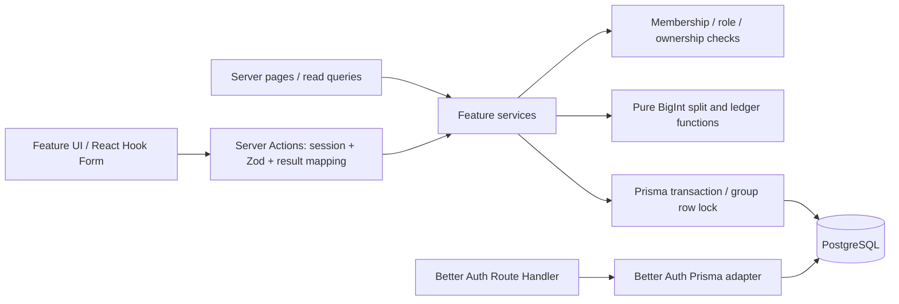
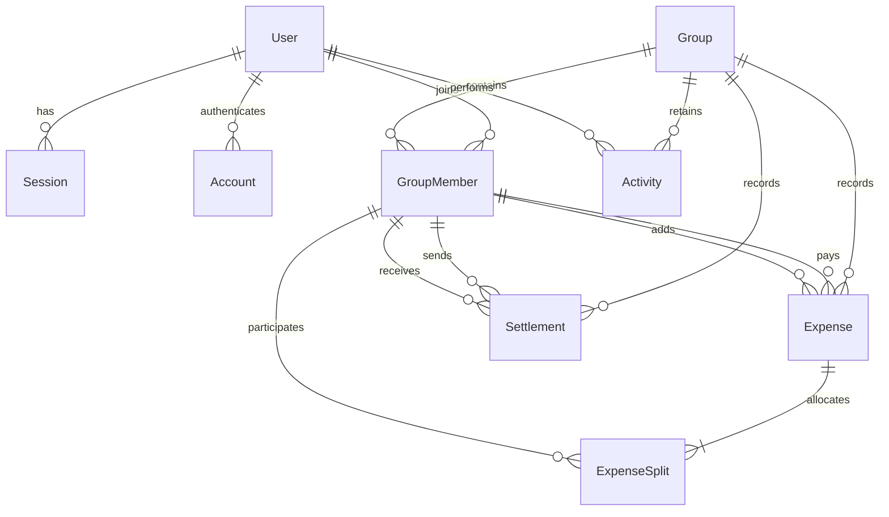

# FairShare architecture proposal

Status: **proposal awaiting approval**. Prepared 4 November 2026 (Asia/Dhaka). No Prisma migration or application refactor has been applied in this phase.

## 1. Repository audit

The repository was empty at the start of the earlier request. A working implementation was subsequently created before the master instructions arrived. Preserve it as a reference; do not pretend it already follows the new stack.

| Area | Existing implementation | Proposed target |
| --- | --- | --- |
| Application | Next.js 16.4.5 App Router, strict TypeScript, React 19 | Retain; Node runtime |
| UI | Custom CSS, native controls, Lucide, one large dashboard | Tailwind + shadcn/ui; separate feature and layout components |
| Forms | React state + native form validation + server Zod | React Hook Form + Zod resolver; server Zod remains mandatory |
| Database | PostgreSQL, Drizzle, hand-written SQL migration | Prisma ORM, reviewed Prisma Migrate migrations |
| Authentication | Better Auth, Drizzle adapter, real database sessions | Better Auth, Prisma adapter; preserve library-managed auth |
| Mutations | JSON Route Handlers call a shared service | Server Actions call feature services |
| Money | Bounded integer numbers, BigInt proportional products | BigInt poisha end to end; string transport |
| Expense splits | JSONB allocations on expense | Relational ExpenseSplit rows with membership foreign keys |
| Tests | Node test runner, HTTP integration script | Vitest unit/integration suites, separate PostgreSQL test DB |
| Git | No commits yet; generated files untracked | Review and checkpoint baseline, then meaningful phase commits |

Current checks: strict TypeScript and 12 unit tests pass (including 4,000 generated allocation cases). Earlier HTTP verification passed 42 assertions against the local PostgreSQL/demo database. A later former-member safeguard has unit/type checks but its added HTTP regression checks have **not** been run yet. Production Webpack build passed before those last small changes. ESLint is not installed/configured. This is evidence about the existing implementation, not verification of the proposed Prisma design.

## 2. Architecture and boundaries



Server Components load authorized dashboard/group DTOs and keep database access on the server. Client Components own forms, tabs, confirmation dialogs and feedback. No DB client or auth secret crosses this boundary.

Server Actions are public mutation endpoints in security terms. Each derives its actor from Better Auth's current server session, parses unknown input, invokes a service, maps domain errors to typed field/form errors, and revalidates affected routes after commit. It must never trust a posted actor or role. Reads use server-only query functions with the same authorization rules. Auth stays on `/api/auth/[...all]`. Future CSV download or external API support is an appropriate reason for a Route Handler; no separate Express server.

Services orchestrate rules and transactions. Split, balance and suggestion functions have no database, clock, session, or React dependencies. Domain logic will be moved out of the existing catch-all service module into practical feature modules, without a generic repository framework.

| Boundary | Planned operations | Transaction responsibility |
| --- | --- | --- |
| Group actions/service | create, issue/rotate invite, join, leave/remove, delete | Create admin membership; lock group for joins/removals/deletion; audit changes |
| Expense actions/service | create, edit, delete | Lock group; authorize author/admin; check version; validate members; calculate splits; persist expense/splits/audit atomically |
| Balance query/service | overview, group totals, per-member breakdown | Repeatable-read snapshot; bulk ledger query; verify zero sum |
| Settlement action/service | record payment | Lock group; verify parties and current debt; enforce idempotency; insert settlement/audit |
| Activity queries/service | group feed with cursor | Authorize membership; stable timestamp+ID cursor; read snapshots |
| Authentication | Better Auth endpoints/client | Better Auth adapter-managed account/session operations |

## 3. Entity relationship design



Better Auth also owns a Verification table. Group membership is unique by `(groupId, userId)`, with role and active status. Membership rows are retained when somebody leaves. An expense has one payer, one author, a date-only expense date, a version and its included members' exact poisha allocations. The payer may be excluded from the split. Composite foreign keys bind payer, author, split participants and settlement parties to the expense/payment's group. An audit snapshot contains decimal **strings** for BigInt fields.

The proposed schema is in `prisma/schema.proposal.prisma`. It is deliberately inactive. Provider/client configuration and validation will be finalized against the pinned Prisma release in the approved implementation phase. Prisma configuration is version-sensitive; do not automatically adopt a major upgrade or assume an old tutorial's config works.

Additional reviewed SQL migration constraints: amount > 0 and <= the chosen maximum; allocation >= 0; settlement sender != receiver; percentage bounds; positive integer shares; supported roles and enums; only one active admin initially. Sum-of-splits is a cross-row invariant checked inside the locked service transaction (ordinary CHECK constraints cannot enforce a cross-row sum). Use a database trigger to reject application UPDATE/DELETE of activity rows; privileged retention maintenance is separate. Group deletion is a soft deletion so the audit trail remains intact.

## 4. Practical target structure

```text
src/
  app/
    (auth)/login/page.tsx
    (dashboard)/page.tsx
    (dashboard)/groups/[groupId]/page.tsx
    join/[token]/page.tsx
    api/auth/[...all]/route.ts
  components/
    ui/                  # shadcn primitives
    layout/              # sidebar, header, app shell
    shared/              # money display, empty/error/loading states
  features/
    auth/                # auth form
    groups/              # actions, schemas, service, queries, UI
    expenses/            # actions, schemas, service, split engine, UI
    balances/            # pure ledger, authorized queries, breakdown UI
    settlements/         # actions, schemas, service, pure algorithm, UI
    activities/          # immutable snapshot writer, authorized feed queries
  lib/
    auth/                # Better Auth server/client integration
    db/                  # Prisma singleton and transaction helper
    permissions/         # requireSession, requireMember, requireAdmin, requireAuthorOrAdmin
    utils/               # BigInt parsing/formatting, DTO serialization
  types/                 # shared serializable contracts where actually reused
prisma/
  schema.prisma          # only after proposal approval
  migrations/
  seed.ts
tests/
  unit/
  integration/
```

Each feature owns its service beside its actions and schema. We will not also create a duplicate top-level `services/` layer. The suggested structure in the master instructions is guidance, and duplicated service locations would make ownership less clear.

## 5. Financial strategy

Parse decimal text by splitting whole/fraction strings and constructing BigInt poisha. Reject signs, exponents, NaN, extra decimals, missing values, excessive length and amounts above BDT 1,000,000 per expense/payment. Do not use parseFloat, amount*100 on decimal numbers, or Number conversion for calculations. Format with integer quotient/remainder; use localized grouping without converting balances to floating-point values. All action/JSON DTO monetary fields are base-10 strings; only pure domain functions and Prisma use BigInt.

Equal: stable sorted member IDs, quotient allocation, then deterministic remainder order rotated by a stable expense ID hash. Percentage: parse to integer basis points (two decimal percent precision), sum exactly 10,000. Shares: positive integers only (unlike the existing implementation's accepted fractional weights). Percentage/shares use BigInt numerator/divisor, floor each share, then largest remainder allocation. Tied remainders use the same rotated ordering. Preserve the expense ID across edits. One-poisha allocations and payer-not-included cases are explicit tests. Rotation reduces systematic bias; it does not guarantee that every person receives exactly the same number of remainder poisha over time.

Positive balance = is owed; negative = owes. Credit full payment to the payer, debit participant allocations, add settlements sent, subtract settlements received. Retain departed members in historic ledger calculations. Every calculation asserts sum == 0n; fail visibly rather than return a plausible but corrupt number.

Use deterministic largest-debtor/largest-creditor greedy suggestions. They clear the ledger with at most k-1 positive payments for k nonzero balances. They do not promise a global minimum. An exact optimizer is outside the initial time box.

## 6. Security and consistency strategy

- Authenticate every action and query. Group IDs and resource IDs are selectors, never proof of access. Unauthorized group lookups return a generic not-found result.
- Lock the group row in the transaction before checking membership, role, version or balance. All domain writes follow this order, including invite use, removal and deletion; concurrent writers serialize per group.
- Scope resource reads/writes by both groupId and resourceId. Composite foreign keys provide additional group membership protection.
- Author/admin rules use immutable creator identity. A member cannot edit another member's expense even if the payer is themselves.
- Use an expected version for edits/deletes. A stale request produces a conflict; the user must refresh.
- Allow settlements only between a current debtor and creditor, up to both current limits. Only an involved party/admin can record. Scope a client request key to actor/group and validate identical payload on retry. A retry must not create a second payment.
- Block removal/leave unless net balance is zero. Freeze edits/deletion of expenses involving former members until they rejoin, preventing historical changes from reopening unreachable balances.
- Use high-entropy invite tokens, store only hashes, expire links after seven days, and rotate/revoke atomically. Initial permission policy: admins issue/revoke invitations. Apply shared rate limits before production; avoid claiming in-memory limits protect multiple instances.
- Configure Better Auth secure cookies on HTTPS, explicit trusted origins and server session checks. No custom passwords, JWT sessions or cookie crypto. No secret in a client bundle or committed file.
- Server Actions retain Next.js origin checks. Validate all Zod payloads with size/length/member limits. Auth forms also receive server validation through Better Auth.
- Audit records include actor, event, entity ID, immutable before/after snapshots and server time. Deleted expenses do not delete events. Deleted groups are hidden via deletedAt; audit data stays retained under explicit policy.

## 7. Testing and review strategy

Vitest unit tests cover parsing/formatting, all splits, deterministic remainder tie ordering, integer-only shares, proportional large products, zero-sum ledgers, settlement sign conventions and greedy counterexample. Generated property cases check conservation and valid suggestions across member counts and amounts.

Use a **dedicated PostgreSQL test database** named `fairshare_test` (or an equivalent isolated test URL), never the demo/development database. Fail fast if the integration URL points at the development database. Apply the same Prisma migrations. Run transactional permission, persistence, audit and concurrency tests against real PostgreSQL. Parallel tests use unique groups/users; cleanup is limited to those fixtures. Do not replace locking or constraints with SQLite or an in-memory mock.

Test forged actor/role fields, cross-group member/payer/resource IDs, expired/revoked invites, non-member reads/writes, author/admin rules, stale versions, simultaneous settlements, duplicate retries, removal with debt, former-member history changes, old edits after settlement, and rollback when audit insertion fails. Exercise Better Auth registration/sign-in/session/sign-out integration. Browser checks cover desktop/mobile navigation, all split form modes, errors and confirmation flows. Retain a small reproducible manual smoke checklist instead of adding browser infrastructure prematurely.

Every approved phase ends with `typecheck`, ESLint, relevant Vitest tests, security review and a diff review. The final phase also requires a production build, complete browser flow and honest submission checklist. Missing tools/checks are reported as missing; no test suppression or fake results.

## 8. Risks, contradictions and omissions

1. The PDF permits Drizzle and Route Handlers; the newer master instructions mandate Prisma and Server Actions. Follow the newer instructions. This is a deliberate migration of an existing implementation, not a greenfield repository anymore.
2. Existing HTTP tests used the demo DB with isolated temporary fixtures. The new requirement explicitly asks for a separate test DB; replace that approach before calling the target test setup complete.
3. The existing shares engine accepts decimals. The master instructions require positive integer weights. Preserve the old test baseline, then add rejection cases and change the behavior in the financial phase.
4. “As few transactions as possible” can suggest global optimality, while the clarification permits greedy. The UI/docs must say suggestions, show the guarantee actually provided, and include a counterexample.
5. A zero-balance departure alone is insufficient: a later old-expense edit can create a new debt for somebody who cannot access the group. Proposed former-member freeze closes that gap.
6. Immutable group history conflicts with hard group deletion. Prefer soft deletion, immediate invite revocation and hidden group access. Retention and account erasure policy remain a production decision.
7. A recorded settlement is a claim, not proof of a transfer. Labels are not a bKash integration. Keep this visible. Disputes, receiver confirmation and settlement correction/reversal need a follow-up policy; do not silently overwrite recorded payments.
8. The brief omits password reset/email verification, invite expiry, data retention/backups and external rate limiting. Prioritize the assessment core; document deployment limitations honestly.
9. Local time/date handling can change a date-only expense. Store SQL DATE; timestamp activity in UTC and render in the user's timezone. Do not infer the 72-hour deadline from this chat's start; receipt time is unknown.
10. The master requires stopping for approval after each phase, which adds waiting time to the 8–12 hour effort target. Count implementation effort separately and keep the phases small.
11. Part B and Part C require personal reflection. AI can provide drafts and an accurate activity log, but cannot honestly invent work the candidate wrote or claim the candidate's own reasoning. Candidate review is mandatory before submission.
12. Current group pages return all expenses; 5,000 rows will hurt network/rendering. Proposed pagination and SQL aggregate queries avoid loading entire ledgers into the browser. Use EXPLAIN ANALYZE before caches; do not store manually editable balances.

## References checked

- [Prisma + Better Auth + Next.js integration](https://docs.prisma.io/docs/guides/authentication/better-auth/nextjs)
- [Prisma v7 relational modeling](https://www.prisma.io/docs/orm/v7/prisma-schema/data-model/relations)
- [Prisma schema types and relation fields](https://docs.prisma.io/docs/orm/reference/prisma-schema-reference)
- Next.js installed guides: `node_modules/next/dist/docs/01-app/01-getting-started/15-route-handlers.md` and `05-server-and-client-components.md`.

Approval requested: approve this architecture and the staged migration in `plan.md` before any implementation/dependency/schema changes.
